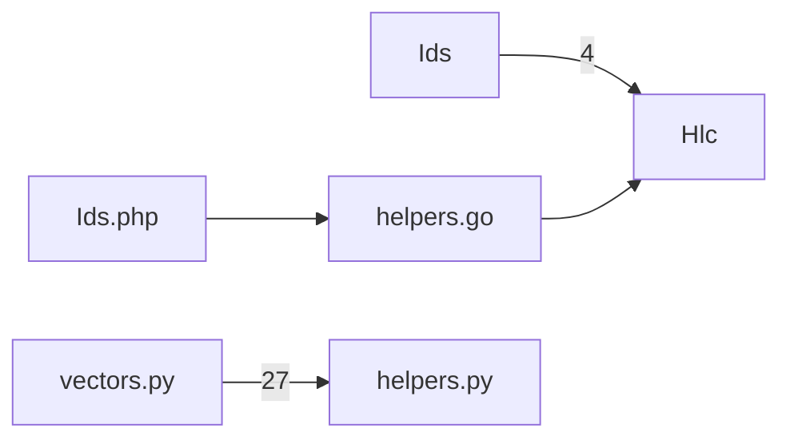

Code map: catboy-registry — 6 components, 4 call-dependencies (top); core: Hlc, helpers.go, helpers.py, vectors.py

_Auto-generated (deterministic, no AI) from the symbol index._

## Core components (PageRank — most depended-upon)
- `Hlc` — 0.338
- `helpers.go` — 0.183
- `helpers.py` — 0.183
- `vectors.py` — 0.099
- `Ids` — 0.099
- `Ids.php` — 0.099

## Call dependencies (who calls whom)

## Largest components (by member count)
- `Ids` — 15 members
- `Program` — 11 members
- `Hlc` — 7 members
