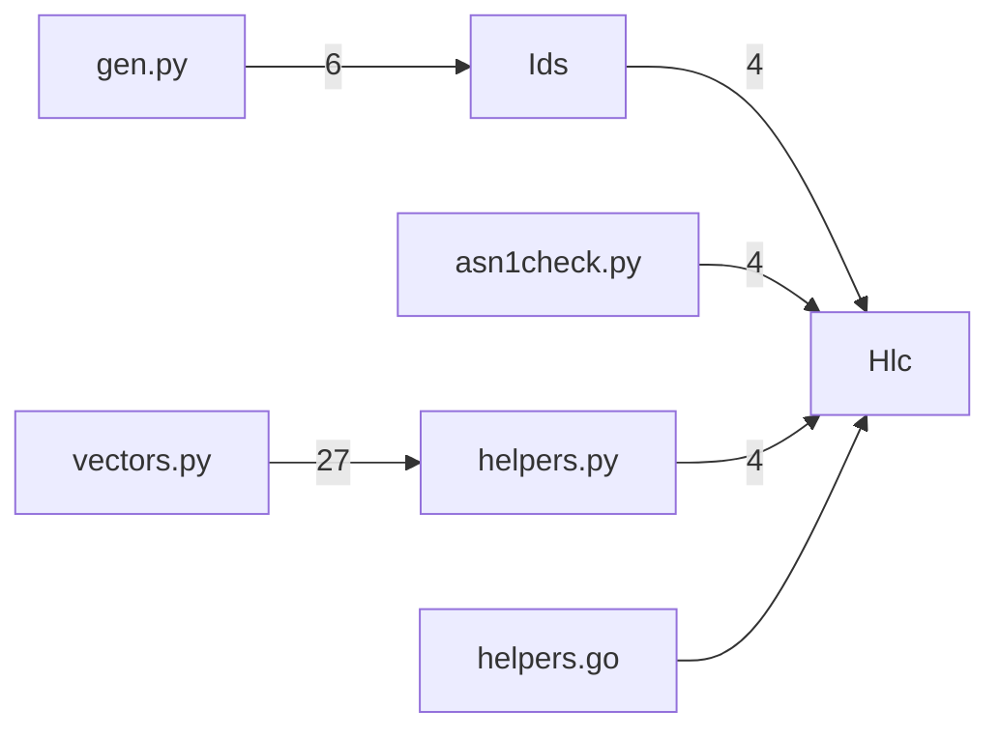

Code map: catboy-registry — 7 components, 6 call-dependencies (top); core: Hlc, helpers.py, Ids, helpers.go

_Auto-generated (deterministic, no AI) from the symbol index._

## Core components (PageRank — most depended-upon)
- `Hlc` — 0.432
- `helpers.py` — 0.137
- `Ids` — 0.137
- `helpers.go` — 0.074
- `asn1check.py` — 0.074
- `vectors.py` — 0.074
- `gen.py` — 0.074

## Call dependencies (who calls whom)

## Largest components (by member count)
- `Ids` — 29 members
- `Hlc` — 14 members
- `Program` — 11 members
